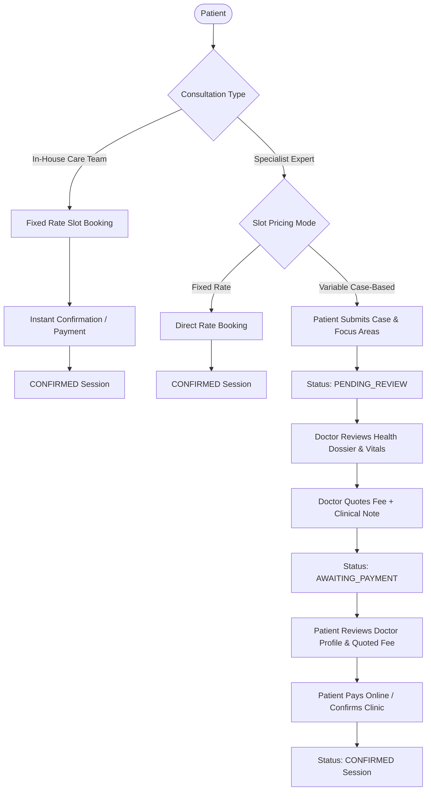
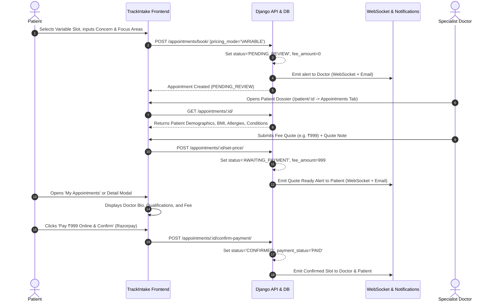

# TrackIntake — Clinical Consultation, Case-Based Pricing & In-House Architecture

---

## 1. Executive Summary & Architecture Overview

TrackIntake supports a dual-tier clinical consultation architecture designed to seamlessly accommodate two distinct healthcare models within a unified platform:

1. **In-House Wellness Team (Platform Practitioners):** Dedicated platform healthcare providers operating under standardized, platform-controlled rates with instant booking and fixed-slot availability.
2. **Specialist Expert Practitioners (Independent Clinicians):** Credentialed specialists (e.g., pediatric nutritionists, oncology dietitians, bariatric experts) with custom consultation rates, direct rate publication, and **2-step Case-Based (Variable) Fee Assessment**.

This architecture unifies real-time clinical intake, health dossiers, automated multi-channel notifications (WebSockets + Email), strict rescheduling/cancellation enforcement, and a high-contrast White, Black, and TrackIntake Orange (`#F26722`) user interface.

---

## 2. Core Business Logic & Workflows

### 2.1 In-House vs. Specialist Expert Differentiation

| Dimension | In-House Care Team | Specialist Expert |
| :--- | :--- | :--- |
| **Practitioner Category** | `IN_HOUSE` | `EXPERT` |
| **Rate Governance** | Platform-governed via Django Admin (`InHousePricingConfig`) | Practitioner-governed via profile settings |
| **Pricing Mode Options** | `FIXED` only (variable pricing disabled) | `FIXED` and `VARIABLE` (2-step quote) |
| **Approval Requirement** | No per-practitioner rate edits | Direct rate save; active immediately |
| **Booking Experience** | Direct confirmation at platform fee | Instant booking (Fixed) or 2-Step Quote (Variable) |
| **Badge & Visuals** | "In-House Nutritionist" / `#F26722` badge | "Specialist Expert" / Verified Practitioner badge |

---

### 2.2 Direct Consultation Rates vs. Case-Based Pricing

#### A. In-House Consultation Flow
- **Centralized Admin Configuration:** Rate is managed globally in Django Admin via `InHousePricingConfig` (e.g., ₹499).
- **No False Platform Membership Claims:** The booking interface directly displays the applicable rate (`Rate: ₹499 • Dedicated platform care`) rather than ambiguous statements such as *"Included with Platform Membership"*.
- **Enforced Slot Nature:** When an in-house practitioner creates availability slots via `AddAvailability.jsx`, the pricing mode is locked to `FIXED` to maintain platform rate parity.

#### B. Specialist Direct Rates
- Specialists independently specify `online_price` (Virtual Zoom) and `offline_price` (In-Clinic visits).
- Rate adjustments saved on `NutritionistProfile.jsx` write directly to database fields without requiring administrative gatekeeping, enabling practitioners to adjust pricing to market conditions.

#### C. 2-Step Case-Based (Variable) Fee Assessment
For complex clinical cases (e.g., renal failure, autoimmune diets, diabetic nephropathy), specialists need to assess clinical complexity before committing to a consultation fee:

1. **Step 1: Patient Case Submission**
   - The patient selects a Variable Price slot.
   - The patient enters a mandatory **Consultation Reason & Concern** and selects known Focus Areas.
   - Appointment is created with `status = "PENDING_REVIEW"`, `pricing_mode = "VARIABLE"`, and `fee_amount = 0`.
2. **Step 2: Specialist Health Dossier Audit & Quoting**
   - The doctor receives an automated notification and opens `AppointmentDetailModal.jsx`.
   - The doctor inspects the complete **Patient Health Dossier & Vitals**:
     - Demographics (Age, Gender)
     - Vitals (Height, Weight, Calculated BMI, Activity Level)
     - Primary Health Goal
     - Known Allergies
     - Diagnosed Clinical Conditions
   - The doctor enters the proposed fee (`price`) and an optional note to the patient, then submits.
   - Status transitions to `AWAITING_PAYMENT`.
3. **Step 3: Patient Case Review & Payment**
   - In `MyAppointments.jsx`, the card displays a high-contrast quote card with badge `Quote Ready - Pay Now` and payment status `Quote Ready (Unpaid)` (never `Paid Online / Quota`).
   - The patient reviews the specialist's complete verified profile: qualifications, bio, clinical experience, organization, and specializations.
   - The patient confirms and pays online via Razorpay (or opts for Pay at Clinic if in-person).
   - Once payment is confirmed, the status transitions to `CONFIRMED`.

---

### 2.3 Diet Plan Architecture with Multiple Practitioners

A patient may consult both an In-House practitioner (for routine wellness) and an Independent Specialist (for complex conditions).

- **Multi-Practitioner Assignment:** A patient can be assigned to an In-House nutritionist, an Expert nutritionist, or both simultaneously via the Django Admin panel (`assigned_nutritionist` and M2M/appointment links).
- **Diet Plan Authoring:** Both practitioners have full authorization to generate, modify, and assign structured meal plans for the patient via `PatientDetailsPage.jsx` (`Diet Plans` tab).
- **Conflict Resolution & Display Priority:**
  - In `Daily Meals` (`/dashboard/meals`), active prescribed plans are queried based on `is_active=True` and target date.
  - When multiple diet plans exist, plans are displayed with practitioner attribution so the patient can view meal guidance from each consultant clearly.
  - Diet plan recommendations are saved with practitioner metadata to maintain audit integrity.

---

### 2.4 Real-Time Notification & Alert Infrastructure

1. **WebSocket Notifications (`features/consumers.py`):**
   - Daphne and Django Channels maintain authenticated WebSocket sessions for active users.
   - When an appointment is booked, quoted, rescheduled, or cancelled, a real-time event is broadcasted over the user's notification group.
   - Active users see immediate bell icon badge increments without page reloads.
2. **Persistent In-App Notifications (`AppointmentNotification` model):**
   - Stored in the database with fields `recipient`, `appointment`, `notification_type`, `title`, `message`, `is_read`, and `created_at`.
   - On portal launch, any unread notifications are fetched from the API and surfaced in `NotificationDropdown.jsx`.
3. **Transactional Gmail / SMTP Dispatch (`notification_utils.py`):**
   - Generates formatted HTML email alerts dispatched to practitioner and patient email addresses.
   - Covers events: *Booking Requested*, *Quote Submitted*, *Payment Confirmed*, *Slot Rescheduled*, and *Consultation Cancelled*.

---

### 2.5 Rescheduling, Cancellation & Refund Policy Engine

- **24-Hour Notice Window:** Patients can reschedule or cancel consultations up to 24 hours prior to the slot start time. Within 24 hours, rescheduling is locked for patients to protect practitioner schedules.
- **Reschedule Limit:** Patients are allowed a maximum of **2 reschedules** per booking. Practitioners retain administrative override permissions to reschedule when clinically necessary.
- **Immediate Slot Reopening:** Upon cancellation, the underlying availability slot has its `is_booked` status reset to `False`, immediately releasing it back into the booking calendar for other patients.
- **Automated Refund Audit Engine:**
  - Cancelled by Practitioner: Full refund marked as `PENDING_REFUND` for admin disbursement.
  - Cancelled by Patient > 24 hours: Eligible for refund (`PENDING_REFUND`).
  - Cancelled by Patient < 24 hours: `NO_REFUND` applied in accordance with cancellation policy.

---

### 2.6 Visual Design System & Contrast Specifications

The user interface adheres strictly to a **White, Black, and TrackIntake Orange (`#F26722`)** color palette:

- **Primary Accent:** `#F26722` (TrackIntake Brand Orange) used for primary buttons, active state indicators, accent borders, and practitioner avatars.
- **Card Surfaces:** Pure White (`#FFFFFF`) with 2px solid neutral borders (`#E5E7EB` / `border-neutral-200`). Low-contrast backgrounds and CSS variable fallbacks have been removed.
- **Typography Hierarchy:**
  - Card Titles & Practitioner Names: `font-black text-black`
  - Field Labels (`MODE`, `BOOKED ON`, `FEE`, `PAYMENT`): `text-[10px] font-black uppercase tracking-widest text-neutral-600`
  - Metric Values & Times: `font-black text-black` / `text-[#F26722]`
  - Secondary Context: `text-neutral-800 font-semibold`
- **Status Badges (`STATUS_CONFIG`):** High-contrast badges with solid backgrounds and dark or white text:
  - `CONFIRMED`: `#dcfce7` background with `#000000` text and `#86efac` border.
  - `AWAITING_PAYMENT`: `#F26722` solid background with `#FFFFFF` text and `#ea580c` border.
  - `PENDING_REVIEW`: `#ffedd5` background with `#000000` text and `#fdba74` border.
  - `CANCELLED`: `#fee2e2` background with `#000000` text and `#fca5a5` border.

---

## 3. Comprehensive Task & Change Log (Yesterday through Today)

| # | Task / Feature | Category | Detailed Description & Business Logic | Files Modified | Impact / Verification |
| :-: | :--- | :--- | :--- | :--- | :--- |
| **1** | **Case-Based Pricing Data Architecture** | Backend / DB | Added `pricing_mode` (`FIXED` vs `VARIABLE`), `fee_amount`, `patient_case_summary`, `patient_medical_conditions`, and `nutritionist_quote_note` to the `Appointment` model. Added migration `0007`. | `backend/appointments/models.py` `backend/appointments/serializers.py` | Allows appointments to support 2-step variable pricing alongside fixed rates. |
| **2** | **Fee Quoting & Payment API Endpoints** | Backend | Implemented `set_appointment_price`, `decline_appointment_case`, and `confirm_quoted_payment` endpoints with status transitions (`PENDING_REVIEW` -> `AWAITING_PAYMENT` -> `CONFIRMED`). | `backend/appointments/views.py` `backend/appointments/urls.py` | Doctors can quote custom fees; patients can review profiles and pay. |
| **3** | **Specialist Direct Consultation Rates** | Backend & Frontend | Removed administrative approval requirement for Specialist consultation rates. `online_price` and `offline_price` update directly upon form submission. Added database migration `0006`. | `backend/nutritionist/views.py` `frontend/src/components/components/nutritionist/NutritionistProfile.jsx` | Specialists can independently manage their consultation rates. |
| **4** | **Dual Slot Type Creator for Specialists** | Frontend | Enhanced `AddAvailability.jsx` so Specialists can toggle between "Fixed Price Slot" and "Variable Case Slot (2-Step Quote)". Enforced Fixed mode for In-House practitioners. | `frontend/src/components/components/nutritionist/AddAvailability.jsx` | In-house practitioners are restricted to standard rates; specialists can create variable slots. |
| **5** | **In-House Platform Pricing Config** | Backend & Admin | Created `InHousePricingConfig` singleton model in Django Admin for global platform in-house rate control. Added migration `0007` & `0008`. | `backend/nutritionist/models.py` `backend/nutritionist/admin.py` | Platform administrators can set and update standard in-house consultation fees centrally. |
| **6** | **Patient Intake Dossier & Clinical Vitals** | Backend & Frontend | Serialized patient clinical vitals (`height_cm`, `weight_kg`, `bmi`, `gender`, `age`, `allergies`, `diagnosed_conditions`, `goal`). Displayed in `AppointmentDetailModal.jsx` for all consultations. | `backend/appointments/serializers.py` `frontend/src/components/components/appointments/AppointmentDetailModal.jsx` | Doctors receive full clinical intake context before and during consultations. |
| **7** | **Verified Practitioner Profile Review** | Frontend | Rendered complete doctor profile (photo, bio, qualification, experience, organization, and specializations) inside `AppointmentDetailModal.jsx` when patient is in `AWAITING_PAYMENT` state. | `frontend/src/components/components/appointments/AppointmentDetailModal.jsx` | Patients can review practitioner credentials before paying quoted fees. |
| **8** | **Multi-Practitioner Patient Assignment** | Backend & Admin | Configured Django Admin (`UserAdmin` & `NutritionistAdmin`) so administrators can assign a single patient to both In-House and Specialist practitioners simultaneously without conflicts. | `backend/user/admin.py` `backend/nutritionist/admin.py` | Flexible care team modeling where patients consult multiple practitioners. |
| **9** | **Real-Time WebSockets & In-App Alerts** | Backend & Frontend | Built `AppointmentNotification` model and migration `0008`. Linked WebSocket channel events and updated `NotificationDropdown.jsx` to fetch unread notifications. | `backend/appointments/models.py` `backend/features/consumers.py` `frontend/src/components/components/NotificationDropdown.jsx` | Instant bell icon updates on booking, fee quotes, reschedules, and cancellations. |
| **10** | **Transactional Email Notifications** | Backend | Built `notification_utils.py` to dispatch HTML emails to patients and practitioners upon booking request, price quote submission, confirmation, and cancellation. | `backend/appointments/notification_utils.py` `backend/appointments/views.py` | Multi-channel communication ensures users are alerted outside the app. |
| **11** | **Removal of False Membership Claims** | Frontend | Removed *"Included with Platform Membership"* and *"Included in plan / Quota"* labels. Updated booking cards to display direct rates (`Rate: ₹{rate} • Dedicated platform care`). | `frontend/src/components/components/appointments/BookAppointment.jsx` `frontend/src/components/components/appointments/SlotPicker.jsx` | Transparent pricing display eliminates patient confusion regarding payment obligations. |
| **12** | **White, Black & Orange Theme Overhaul** | Frontend | Replaced low-contrast blue/teal gradients with pure White surfaces, solid Black text, and TrackIntake Orange (`#F26722`) accents across all appointment cards and modals. | `frontend/src/components/components/appointments/MyAppointments.jsx` `frontend/src/components/components/appointments/AppointmentDetailModal.jsx` | Eliminates low-contrast text and aligns with brand identity. |
| **13** | **Accurate Payment Status on Unpaid Quotes** | Frontend | Fixed appointment card logic so appointments in `AWAITING_PAYMENT` show `Quote Ready (Unpaid)` instead of incorrectly falling back to `Paid Online / Quota`. | `frontend/src/components/components/appointments/MyAppointments.jsx` | Accurate visual feedback for pending payments. |
| **14** | **Reschedule & Cancellation Modals Styling** | Frontend | Restyled `RescheduleModal.jsx` and `CancelModal.jsx` with White, Black, and Orange theme, high-contrast typography, and 24-hour policy callouts. | `frontend/src/components/components/appointments/RescheduleModal.jsx` `frontend/src/components/components/appointments/CancelModal.jsx` | High-contrast modal designs consistent with design system. |
| **15** | **Footer Social Media Hyperlinks** | Frontend | Updated `Footer.jsx` social icons with verified hyperlinks for YouTube, LinkedIn, Instagram, and Twitter/X with `target="_blank"` and `rel="noopener noreferrer"`. | `frontend/src/components/components/Footer.jsx` | Accurate, functional social links across all application views. |
| **16** | **Comprehensive Playwright E2E Test Suite** | Testing & QA | Authored and executed automated Playwright browser test suites verifying all 21 patient tools, 16 nutritionist management features, case pricing flows, contrast rules, and footer links. | `test_new_appointments_and_contrast_playwright.py` `test_case_based_pricing_playwright.py` `patient_test_suite/` `nutritionist_test_suite/` | **63 / 63 tests passed (100% success rate)** across all test suites. |

---

## 4. Verification & Testing Evidence

- **Frontend Compilation:** `npm --prefix frontend run build` completed with 0 errors (`built in 24.68s`).
- **Backend System Health:** `manage.py check` completed with 0 system errors.
- **Playwright Automated Browser Results:**
  - `playwright_test_patient.py`: 21 / 21 PASS (100%)
  - `playwright_test_nutritionist.py`: 16 / 16 PASS (100%)
  - `test_case_based_pricing_playwright.py`: 12 / 12 PASS (100%)
  - `test_new_appointments_and_contrast_playwright.py`: 14 / 14 PASS (100%)
- **Screenshot Artifacts:** Visual proof screenshots captured and preserved under `playwright_screenshots/`.
